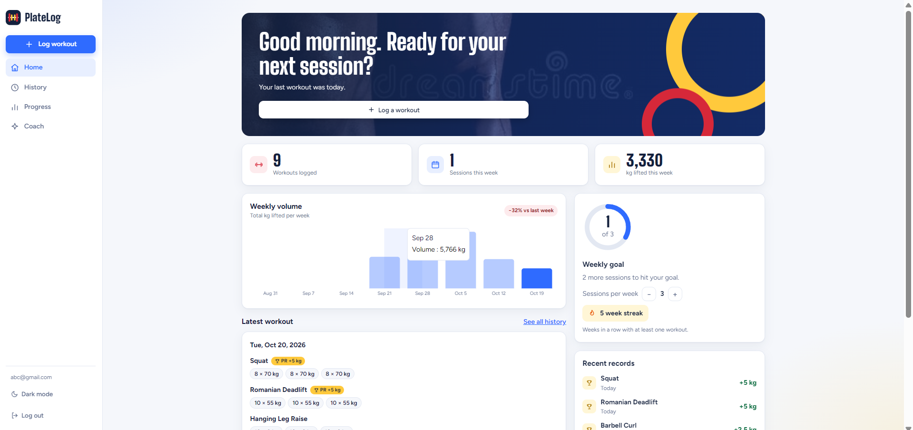
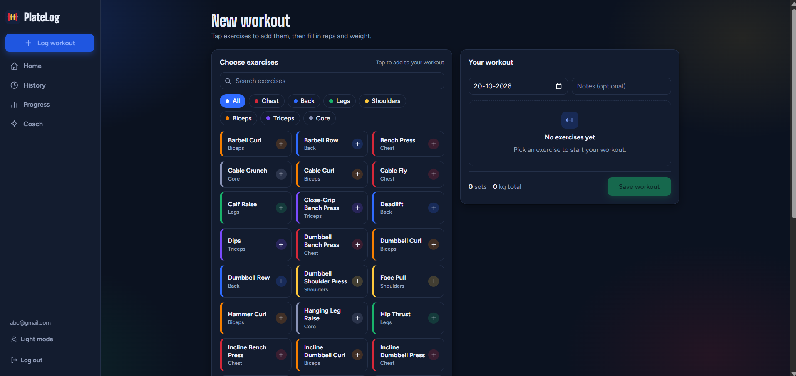
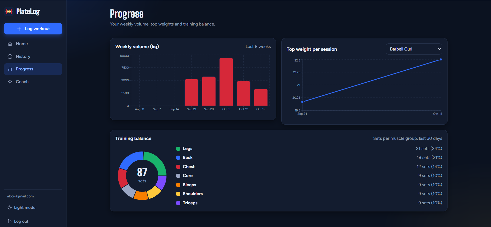
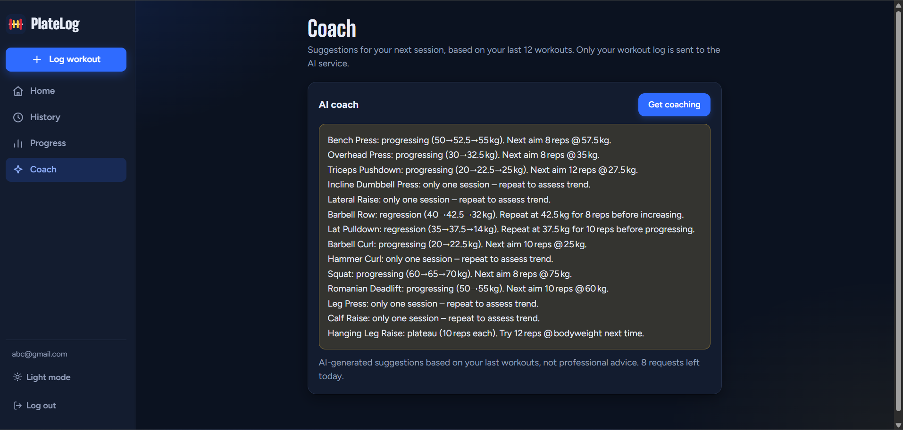

# PlateLog

A full-stack workout tracker: log sets quickly, watch your progress, and get AI coaching for your next session.

**Live demo:** [YOUR_VERCEL_URL](https://platelog-alpha.vercel.app/)
**API docs:** [YOUR_RENDER_URL/docs](https://platelog-x4ax.onrender.com/)

> The backend runs on a free tier and sleeps when idle, so the first request can take up to a minute. Open the link once and give it a moment.



## Features

- **Accounts:** sign up and log in with JWT authentication and hashed passwords.
- **Fast logging:** search and filter a library of 41 starter exercises, group them by muscle, and add your own. The workout builder prefills your last weight and reps.
- **Personal records:** PRs are detected from your full history, with badges and a confetti burst when you beat your best.
- **Progress:** weekly volume, top weight per exercise over time, and a muscle-group balance chart.
- **Motivation:** weekly goal ring and a week streak.
- **AI coach:** suggests targets for your next session from your recent workouts, using an LLM (Groq). Only your workout log is sent, and requests are rate limited per user and globally.
- **Polish:** responsive layout, dark mode, and animations that respect reduced-motion settings.

| Log workout | Progress | Coach |
|---|---|---|
|  |  |  |

## Tech stack

| Layer | Tools |
|---|---|
| Frontend | React, Vite, React Router, Recharts, Motion |
| Backend | FastAPI, SQLAlchemy 2, Pydantic |
| Database | PostgreSQL (Neon) in production, SQLite locally |
| Auth | JWT, argon2 password hashing |
| AI | Groq API |
| Hosting | Vercel (frontend), Render (API), Neon (database) |

## Design decisions

- **Per-user data isolation:** every workout and exercise query is filtered by the logged-in user's id. Requesting another user's workout returns 404, not 403, so ids can't be probed.
- **Exercise ownership is checked on write:** a workout can only reference exercises the user owns.
- **LLM safety and cost control:** the coach sees only the user's workout log, notes are treated as data and not instructions, and there are daily limits per user and across all users to protect the free quota.
- **PRs are computed, not stored:** they are derived from history each time, so deleting or back-dating a workout always keeps them correct.
- **Configuration through environment variables:** the same code runs locally on SQLite and in production on Postgres.

## Run locally

Requires Python 3.13 and Node.js 22.

**Backend**

```bash
cd backend
python -m venv venv
venv\Scripts\activate          # macOS/Linux: source venv/bin/activate
pip install -r requirements.txt
cp .env.example .env           # Windows: copy .env.example .env
# edit .env: set SECRET_KEY and GROQ_API_KEY
uvicorn main:app --reload
```

**Frontend**

```bash
cd frontend
npm install
npm run dev
```

Open http://localhost:5173. With `DATABASE_URL` left empty, the backend uses a local SQLite file.

## Known limitations and roadmap

- Free-tier hosting means cold starts after inactivity.
- Workouts can be deleted but not yet edited.
- No automated tests or CI yet.
- Planned: natural-language logging ("bench 3x8 at 60"), a tool-using coach agent, a rest timer, and database migrations with Alembic.

## Credits

Hero photos from AYush YAdav (free license).